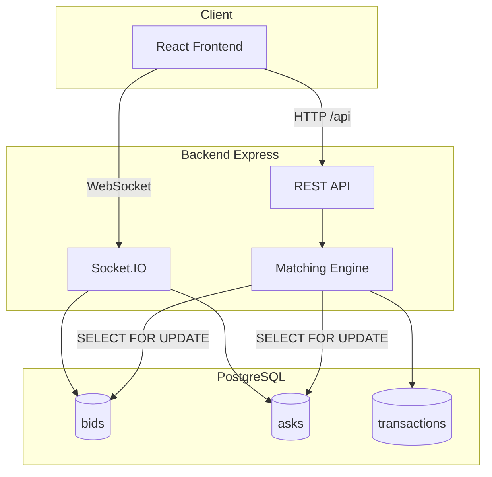

# SneakickS Marketplace

Sàn giao dịch giày sneaker & collectibles theo mô hình **Bid/Ask** (tương tự StockX), xây dựng với **Node.js, Express và PostgreSQL**. Dự án thể hiện kỹ năng thiết kế marketplace, xử lý giao dịch đồng thời, matching engine và xây dựng REST API bảo mật.

---

## Tổng Quan

**SneakickS Marketplace** cho phép người mua đặt **Bid** (giá mua tối đa) và người bán đặt **Ask** (giá bán tối thiểu). Hệ thống **matching engine** tự động ghép cặp lệnh khi giá giao nhau, đảm bảo tính công bằng FIFO và an toàn giao dịch nhờ row locking trong PostgreSQL.

| Thông Tin | Chi Tiết |
|-----------|----------|
| **Backend** | Node.js 18+, Express 4, ES Modules |
| **Frontend** | React 18, Vite, Tailwind CSS |
| **Cơ Sở Dữ Liệu** | PostgreSQL 13+ |
| **Xác Thực** | JWT + bcrypt |
| **Real-time** | Socket.IO (order book live) |
| **Đặc Điểm** | Matching engine với `FOR UPDATE` row locking |
| **Loại Dự Án** | Đồ án nghiên cứu GR1 |

---

## Tính Năng

- **Đăng ký / Đăng nhập** — xác thực JWT, phân quyền user/admin
- **Danh mục sản phẩm** — browse sneaker theo category, xem chi tiết, biểu đồ lịch sử giá
- **Đặt Bid & Ask** — đặt lệnh mua/bán với giá tùy chọn
- **Buy Now / Sell Now** — khớp lệnh ngay lập tức với giá tốt nhất trên sổ lệnh
- **Matching Engine** — tự động ghép cặp bid/ask theo FIFO, xử lý race condition
- **Quản lý giao dịch** — vòng đời đơn hàng: pending → shipped → verification → completed
- **Verification Center** — admin xác minh sản phẩm (pass/fail)
- **Seller Trust Score** — đánh giá người bán sau giao dịch hoàn tất
- **Wishlist** — theo dõi sản phẩm yêu thích
- **Order Book Real-time** — cập nhật sổ lệnh live qua Socket.IO
- **Phân trang** — offset và keyset (cursor) pagination cho danh sách sản phẩm

---

## Kiến Trúc Dự Án

```
SneakickS-Marketplace/
└── SneakickS/
    ├── sneakicks-backend/     # REST API + Matching Engine (port 3000)
    │   └── src/
    │       ├── controllers/   # Auth, Product, Bid, Ask, Transaction
    │       ├── services/      # matchingEngine.js
    │       ├── models/        # User, Product, Bid, Ask, Transaction
    │       ├── routes/        # API routers
    │       ├── middlewares/ # JWT auth, error handler
    │       └── realtime/      # Socket.IO handlers
    └── sneakicks-frontend/    # React SPA (Vite)
        └── src/
            ├── pages/         # Home, Product, Orders, Admin
            ├── api/           # Axios client
            └── realtime/      # Socket.IO client
```



---

## Điểm Kỹ Thuật Nổi Bật

### 1. Matching Engine

Toàn bộ thao tác khớp lệnh chạy trong **PostgreSQL transaction** (`withTransaction`):

- **FIFO:** Ask thấp nhất = `price ASC, created_at ASC`; Bid cao nhất = `price DESC, created_at ASC`
- **Row Locking:** `SELECT ... FOR UPDATE` trên dòng đối ứng — ngăn race condition khi nhiều request đồng thời
- **matchNewBid:** tạo bid → khóa ask thấp nhất có `ask.price <= bid.price` → tạo transaction tại giá ask
- **matchNewAsk:** đối xứng → transaction tại giá bid
- **Buy Now / Sell Now:** khớp trực tiếp không tạo lệnh mới, chặn self-trade

### 2. Vòng Đời Giao Dịch

```
pending_shipment → shipped_to_verify → completed
                                    ↘ failed (admin verification)
```

Mỗi thay đổi trạng thái được ghi audit log trong `order_status_logs`.

### 3. Real-time Order Book

Socket.IO event `join:product` / `leave:product` → broadcast `product:update` khi sổ lệnh thay đổi.

---

## Yêu Cầu Hệ Thống

- **Node.js 18+**
- **PostgreSQL 13+** đang chạy
- **npm** hoặc **yarn**

---

## Cách Chạy Dự Án

### Backend

```bash
cd SneakickS/sneakicks-backend

npm install
cp .env.example .env
# Chỉnh .env: DB_HOST, DB_USER, DB_PASSWORD, JWT_SECRET, ...
```

Tạo database:

```sql
CREATE DATABASE sneakicks;
```

```bash
npm run db:migrate
npm run dev
```

> Backend chạy tại `http://localhost:3000`

### Frontend

```bash
cd SneakickS/sneakicks-frontend

npm install
npm run dev
```

> Frontend chạy qua Vite, proxy API tới `http://localhost:3000`

---

## API (Tóm Tắt)

| Nhóm | Endpoint | Mô Tả |
|------|----------|--------|
| **Public** | `GET /api/products` | Danh sách sản phẩm (pagination) |
| | `GET /api/products/:id/orderbook` | Sổ lệnh bid/ask |
| | `GET /api/products/:id/price-history` | Lịch sử giá |
| | `POST /api/auth/register` | Đăng ký |
| | `POST /api/auth/login` | Đăng nhập |
| **Cần JWT** | `POST /api/bids` | Đặt lệnh mua |
| | `POST /api/asks` | Đặt lệnh bán |
| | `POST /api/bids/buy-now` | Mua ngay |
| | `GET /api/transactions/me` | Lịch sử giao dịch |
| | `POST /api/follows` | Thêm wishlist |
| **Admin** | `GET /api/admin/verifications` | Danh sách xác minh |
| | `POST /api/admin/verifications/:id/pass` | Duyệt sản phẩm |

---

## Tài Khoản Test

Sau khi chạy `npm run db:migrate`:

| Email | Mật Khẩu | Vai Trò |
|-------|----------|---------|
| `admin@sneakicks.com` | `admin123` | Admin |
| `buyer1@sneakicks.com` | `buyer123` | Người mua |
| `seller1@sneakicks.com` | `seller123` | Người bán |

---

## Cấu Trúc Thư Mục

```
SneakickS-Marketplace/
├── README.md
└── SneakickS/
    ├── sneakicks-backend/
    │   ├── server.js              # Entry point
    │   ├── src/
    │   │   ├── services/matchingEngine.js
    │   │   ├── db/schema.sql      # 10 bảng PostgreSQL
    │   │   └── realtime/          # Socket.IO
    │   └── tests/                 # Postman, concurrent test
    └── sneakicks-frontend/
        └── src/                     # React pages & components
```

---

## Cấu Hình

File `SneakickS/sneakicks-backend/.env`:

| Biến | Mô Tả |
|------|--------|
| `DB_HOST` | Host PostgreSQL |
| `DB_USER` / `DB_PASSWORD` | Thông tin đăng nhập DB |
| `DB_NAME` | Tên database (`sneakicks`) |
| `JWT_SECRET` | Khóa ký JWT |
| `PORT` | Port server (mặc định 3000) |

---

## Kỹ Năng Thể Hiện Qua Dự Án

- **Marketplace Logic:** Thiết kế sổ lệnh Bid/Ask, matching algorithm kiểu StockX
- **Concurrency Control:** PostgreSQL `FOR UPDATE` row locking, transaction isolation
- **REST API Design:** JWT authentication, role-based admin routes, pagination
- **Real-time Systems:** Socket.IO broadcast cho order book live updates
- **Database Design:** 10 bảng quan hệ (users, products, bids, asks, transactions, verifications, ratings, follows)
- **Full-Stack:** Backend API + React frontend với Tailwind, biểu đồ giá Recharts
- **Testing Mindset:** Concurrent matching test, Postman collection, socket test

---

## Hướng Phát Triển

- [x] Backend scaffold, PostgreSQL, auth, bid/ask, matching engine
- [x] Frontend React, transaction lifecycle, admin verification
- [x] Wishlist, Socket.IO realtime, price charts, keyset pagination
- [ ] Payment gateway tích hợp (Stripe/VNPay)
- [ ] Docker compose cho deploy production
- [ ] E2E test với Playwright

---

## Giấy Phép

Dự án học tập — chưa cấp phép thương mại.
